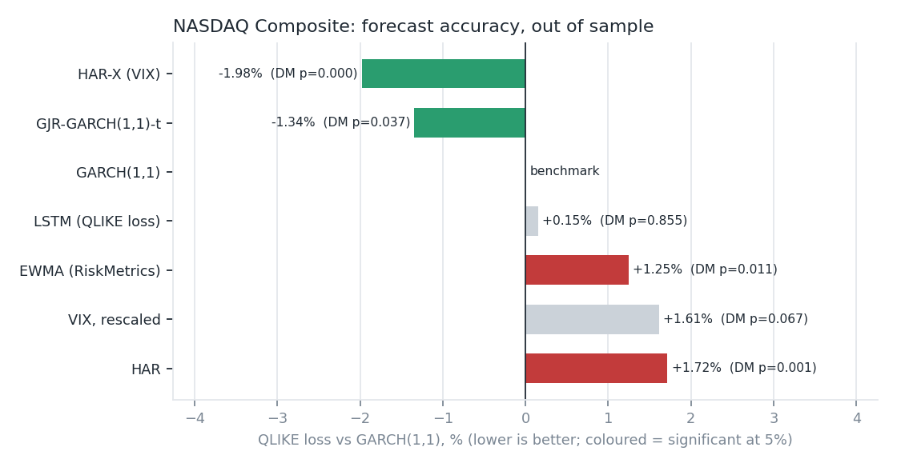
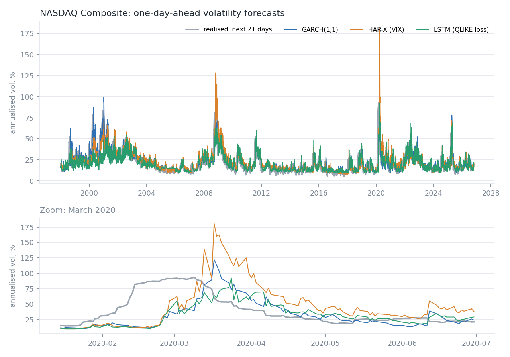
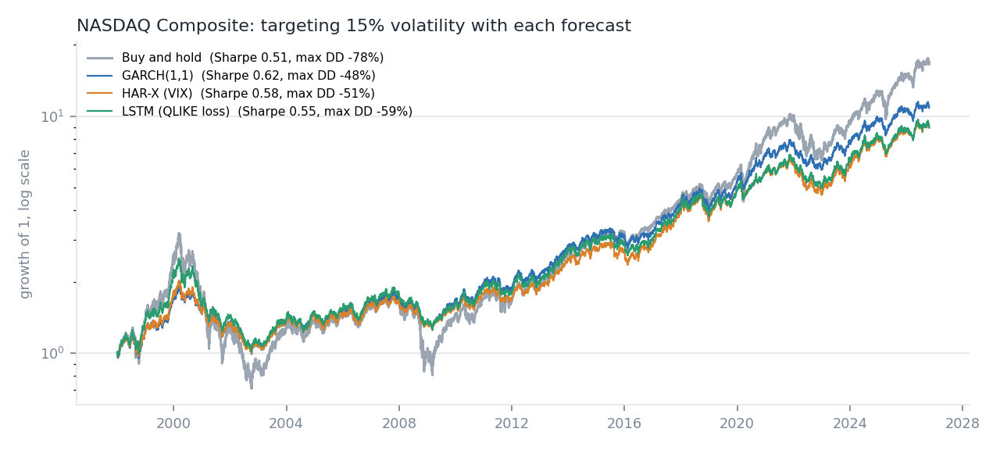
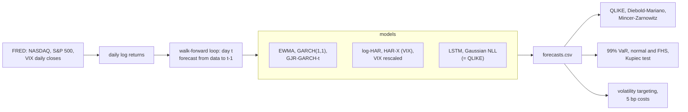

# Equity volatility forecasting: GARCH vs HAR vs LSTM, and does it pay?

One-day-ahead variance forecasts for the **NASDAQ Composite (1998–2026, 7,246 out-of-sample days)**
and the **S&P 500 (2020–2026, 1,499 days)**, compared on forecast accuracy, risk (99% VaR) and
economic value (a volatility-targeting strategy with trading costs). Everything is walk-forward:
no forecast uses information after the close of the previous day, and a test checks that.



## Findings

1. **The best forecasts come from simple models that use the VIX.** A log-HAR with the VIX
   cuts QLIKE loss by 2.0% against GARCH(1,1) on the NASDAQ (Diebold-Mariano p < 0.001), and
   GJR-GARCH with Student-t errors by 1.3% (p = 0.037). On the S&P 500 since 2020 the gains are
   larger: −5.5% (GJR) and −5.0% (HAR-X).
2. **The LSTM does not beat GARCH(1,1).** Trained with the same QLIKE loss, retrained every year
   on all past data and averaged over three seeds, it lands at +0.15% on the NASDAQ (p = 0.86) and
   −1.3% on the S&P 500 (p = 0.60): not significantly different from a three-parameter model.
3. **The normal quantile, not the variance forecast, breaks the 99% VaR.** On the NASDAQ every
   model's normal VaR is breached on 1.5–2.5% of days instead of 1%, and the Kupiec test rejects
   all of them. Taking the quantile from past standardised returns instead (filtered historical
   simulation) brings breaches down to 1.1–1.3%, and the test no longer rejects five of the seven
   models. The excess left, about 0.2 points, is the bias of estimating a 1% quantile from 500
   days; a simulation in the tests reproduces it. On the S&P 500's shorter sample the picture is
   mixed (1.2–1.8%).
4. **Volatility targeting buys risk control, not return.** Targeting 15% a year lifts the NASDAQ
   Sharpe ratio from 0.51 to 0.62 and cuts the maximum drawdown from −78% to −48%, but compound
   growth falls from 10.3% to 8.6% a year. On the S&P 500 since 2020 it lowered the Sharpe ratio
   (0.97 to 0.80): sharp V-shaped recoveries punish de-risking after a shock.
5. **Better statistical forecasts did not make a better strategy.** HAR-X is the most accurate
   model but trades 50% more than GARCH (15.5x vs 10.3x a year) and ends with a lower Sharpe ratio.

| NASDAQ, 1998–2026 | QLIKE vs GARCH | DM p | 99% VaR breaches, normal / FHS | Vol-target Sharpe | Max drawdown |
| --- | --- | --- | --- | --- | --- |
| HAR-X (VIX) | −1.98% | <0.001 | 1.71% / 1.19% | 0.58 | −50.7% |
| GJR-GARCH(1,1)-t | −1.34% | 0.037 | 1.79% / 1.27% | 0.60 | −48.2% |
| GARCH(1,1) | benchmark | | 1.81% / 1.19% | 0.62 | −48.2% |
| LSTM (QLIKE loss) | +0.15% | 0.855 | 2.48% / 1.11% | 0.55 | −59.5% |
| EWMA (RiskMetrics) | +1.25% | 0.011 | 1.93% / 1.24% | 0.62 | −46.5% |
| Buy and hold | | | | 0.51 | −77.9% |

Full tables: [NASDAQ](reports/NASDAQCOM/results.md) · [S&P 500](reports/SP500/results.md).




## Method

**Data.** Daily closes from FRED (`NASDAQCOM` since 1971, `SP500` for the last ten years) and the
Cboe VIX (`VIXCLS`). Returns are daily log returns in percent. The files are downloaded on first
run and not committed, because FRED redistributes them under their owners' terms.

**Models** (all forecast the variance of day *t* from data up to day *t−1*):

| Model | How it is estimated |
| --- | --- |
| EWMA | RiskMetrics, λ = 0.94 |
| GARCH(1,1) | Gaussian, rolling 2,000-day window, refitted every 21 days; between refits the recursion runs on new data with fixed parameters |
| GJR-GARCH(1,1)-t | Same, with a leverage term and Student-t errors |
| HAR | Corsi (2009) on squared returns: daily, weekly and monthly averages, estimated in logs with Duan's smearing correction (a HAR in levels can forecast negative variances) |
| HAR-X (VIX) | HAR plus the VIX-implied daily variance |
| VIX, rescaled | Yesterday's VIX²/252 times a rolling regression slope (the VIX carries a variance risk premium) |
| LSTM | One layer, 32 units, 22-day input window of returns, log HAR components and log VIX; loss = Gaussian NLL (equivalent to QLIKE); retrained every January on all prior data with a 15% early-stopping split; three seeds averaged |

**Evaluation.** The squared daily return is a noisy proxy for the true variance, so models are
ranked by QLIKE, which keeps the ranking consistent under proxy noise (Patton, 2011), and compared
to GARCH(1,1) with Diebold-Mariano tests using Newey-West standard errors. Also reported: MSE,
Mincer-Zarnowitz R², 99% one-day VaR breaches with the Kupiec test (normal quantile, and filtered
historical simulation over the previous 500 standardised returns), and a volatility-targeting
strategy (weight = 15% / forecast vol, capped at 2x, 5 bp cost per unit of weight traded).

## Architecture



## Performance

One full run, `python -m volfc run --index NASDAQCOM`, on a laptop (AMD Ryzen 9 8940HX, RTX 5070 Laptop GPU for
the LSTM): about 7,000 daily out-of-sample forecasts from each of seven models, 1998–2026, with GARCH refitted
every 21 days and the LSTM retrained every January with three seeds. It takes **2.5 minutes, with 1.6 GB peak
memory**. `--no-lstm` runs on any CPU.

## Run it

```bash
pip install -e ".[dev]"
python -m volfc run --index NASDAQCOM                                   # about 3 minutes with a GPU
python -m volfc run --index SP500 --start 2016-10-01 --oos-start 2020-11-01 --window 1000
python -m volfc report --index NASDAQCOM     # rebuild tables and figures from reports/*/forecasts.csv
pytest -q
```

Or in Docker (CI builds the image and runs the tests inside it on every push):

```bash
docker build -t volfc .
docker run --rm -v "$PWD/reports:/app/reports" volfc run --index NASDAQCOM   # CPU; add --no-lstm to skip the LSTM
```

Tests run on simulated GARCH data: parameter recovery, forecasts tracking the true conditional
variance, no look-ahead for EWMA, GARCH and HAR, and the evaluation statistics.

## Limitations

- Squared daily returns are a noisy target; intraday realised variance would separate the models more sharply.
- The indices are price indices (no dividends), cash earns nothing and leverage costs nothing.
- The VIX measures S&P 500 implied volatility; for the NASDAQ it is a proxy (the VXN starts in 2001).
- The S&P 500 sample is short: FRED only provides its last ten years.

## References

Corsi (2009), *A Simple Approximate Long-Memory Model of Realized Volatility*. Patton (2011),
*Volatility forecast comparison using imperfect volatility proxies*. Diebold & Mariano (1995).
Kupiec (1995). Barone-Adesi, Giannopoulos & Vosper (1999), *VaR without correlations for
portfolios of derivative securities*. Moreira & Muir (2017), *Volatility-Managed Portfolios*. Glosten, Jagannathan &
Runkle (1993).
